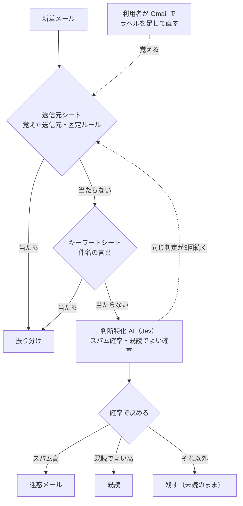

# Gmail 自動振り分け

> 受信箱を「既読・残す・迷惑メール」に自動で片付け、使うほど送信元を覚える仕組み。
> 自分の Google アカウントの中（Google Apps Script）で動くので、メールを外部のサーバーに預けない。

## 解決したこと

- 宣伝・通知メールが多く、大事なメール（人からの連絡、手続き、面談の案内など）が埋もれていた
- 既存のサービスはメールを外部に預ける必要があり、AI に毎回判断させると費用がかさむ

## 仕組み

- **ルールが先、AI は後**：大半のメールは送信元とキーワードのルールで決まり、AI に聞くのは残りだけ
- **迷ったら残す**：確率が基準に届かないものは未読のまま残し、大事なメールを見落とさない側に倒す
- **使うほど賢くなる**：AI の判定が同じ送信元で3回続く、または利用者が直すと、その送信元をルールとして覚える。次からは AI に聞かないので、費用も下がる
- **設定はスプレッドシート**：確率の基準・振り分けの間隔・要約メールの時刻・送信元とキーワードのルールを、コードを触らずに変えられる
- **導入はメニューを押すだけ**：ひな形のスプレッドシートをコピーし、メニュー「はじめる」を押すと動き出す
- **毎朝の要約メール**：未読で残したもの、新しく覚えた送信元、自動で処理した件数が届く
- **AI が使えないときの代わり**：キー未設定やエラーのときは、過去の判定から学ぶナイーブベイズで確率を出す

## 結果（2026年11月、2つの Gmail アカウントで運用）

- 6日間で約240通を処理。ルールで決まったものが約9割、AI に回ったものは約1割（1日3〜4通）
- AI の「既読でよい確率」と利用者の判断がほぼ一致した
  - 利用者が「既読」にしたメール：AI の確率は 81〜93%
  - 利用者が「残す」にしたメール：AI の確率は 22〜61%
  - 読むべきメールを「既読でよい」と判定した間違いは 0 件
- この結果をもとに、利用者に聞く段階をなくし、AI だけで最後まで決める形にした

## 技術

- Google Apps Script（Gmail・スプレッドシート・時間トリガー）
- TypeSafe AI の判断特化モデル Jev（はい／いいえの確率を返す Noul 形式）
- ナイーブベイズ（AI の代わりの簡易計算）
- GitHub Actions + clasp（main に入ると、複数アカウントの GAS へ自動で反映）

## コードについて

コードは非公開です。導入や利用のご相談は、GitHub のプロフィールからご連絡ください。
