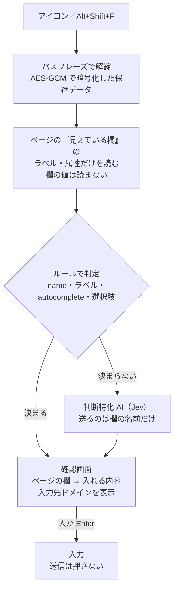

# 個人情報かんたん入力（Chrome 拡張機能）

> 会員登録フォームに、暗号化して保存した個人情報を **確認してから一度に入力** する拡張機能。
> 欄の判定は「ルール＋判断特化 AI（Jev）」の二段構え。**AI に個人情報を渡さない**ことと、**悪意のあるページに吸い取られない**ことを、機能より先に設計した。

## 解決したこと

- 日本のフォームは入力が面倒で、ブラウザ標準の自動入力もうまく合わない（電話が3分割、郵便番号が2分割、姓と名が別欄、「ハイフンなし」指定、ふりがなはひらがな、など）
- 一方、自動入力は **見えない欄に個人情報を吸い取られる**、**外部サービスに渡してしまう**、**平文で保存される** といった危険と隣り合わせ。「便利」と「安全」を両立させたかった

## 仕組み

- **ルールが先、AI は後**：欄の大半はルールで決まる（無料・即時）。決まらない欄だけ Jev に聞く。「プロフィールのどの項目か」を選ばせ、「どれでもない」も選べるようにして、無理に当てはめさせない。確信度が低い答えは捨てる
- **AI に個人情報を渡さない**：Jev に送るのはページ側の欄の名前だけ。登録した値・欄の中身・URL は送らない。ページの文字に個人情報が混ざっていれば伏せ字にしてから送る。Jev は初期設定でオフ
- **必ず人が確認してから入れる**：「どの欄に何を入れるか」の一覧を出し、人が Enter で実行する。AI が決めた欄には印が付く。送信ボタンは押さない。https でないページには警告を出す
- **見えない欄・入れてはいけない欄には入れない**：非表示・画面外・透明・1px・隠した箱・`aria-hidden`・`type=hidden`・iframe の中には入力しない。パスワード・カード番号・認証コード・マイナンバーなどは入力対象にせず、登録もできない
- **保存は暗号化、鍵はメモリだけ**：パスフレーズから PBKDF2（60万回）で鍵を作り、AES-GCM 256bit で暗号化。解錠中の鍵はディスクに書かず、時間で自動施錠。失敗が続くと待たせる
- **権限は最小限**：常駐処理なし。アイコンを押したタブでだけ動く。通信先は1つに限定、外部コードなし

## 結果（2026年11月）

- 自動テスト **66 項目すべて成功**（Playwright で、実際の Chrome に拡張機能として読み込んで検証）
  - 22 欄の割り当てと入力結果、ひらがな変換、ハイフンなし、プルダウン選択
  - 見えない欄 6 種類に入らないこと、AI への送信内容に個人情報がないこと
  - ページが書き換わったら入力しないこと、保存データが暗号化されていること、違うパスフレーズで開かないこと
- 攻撃を再現した **デモサイト** で動作確認。本物の Jev が、ラベルの分かりにくい欄（「日中につながる番号」→電話、「お届け先」→住所 など）を正しく判定し、無関係な欄（「好きな食べ物」）には入れなかった。見えない欄 8 個（iframe 内を含む）にも入らなかった
- 開発中に自分のテストで見つけて直した不具合：1px の箱に隠された欄が「見える」と判定されていた／「市区町村・番地」が市区町村だけ扱いになっていた

## 今後の課題（正直に）

- 他の要素で覆い隠された欄の判定、許可サイトの一覧、パスフレーズの強度判定は未実装
- ページ作者が書く欄の名前で AI の判定を誘導される可能性がある → 選択式・確信度の閾値・人の確認で影響を限定している
- 実サイトでの検証と第三者による脆弱性診断は未実施（そのため自分用に限定している）

## 技術

- Chrome 拡張機能（Manifest V3）、JavaScript（外部ライブラリなし・本体約 1,200 行）
- Web Crypto API（PBKDF2-SHA256・AES-GCM）
- TypeSafe AI の判断特化モデル Jev（選択式 `choice`）
- Playwright（自動テスト）

## 進め方

要件と設計判断は自分で決め、実装とテスト作成は Claude Code と進めた。出力は動かして検証し、不具合は自分のテストで見つけて直した。

## コードについて

コードは非公開です。導入や利用のご相談は、GitHub のプロフィールからご連絡ください。
